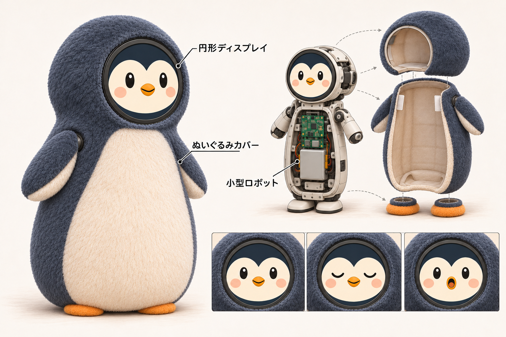
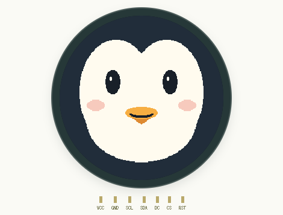

# GarMyFriend-OrangePiZero2W

<!-- board-composition -->
このProductは **アプリ + gar-tools + 基板定義** の3つをsubmoduleで組み合わせます。
組み立て指定は[product.json](product.json)、所有範囲と生成物は[構成の説明](docs/COMPOSITION.md)で確認できます。
`npm run compose`で現在選んでいる部品と版を表示します。


丸い顔で表情を伝える、胴が長く脚が短いペンギンのぬいぐるみロボットを作るプロジェクトです。円形ディスプレイに白い顔模様とオレンジのくちばしを描き、小型ロボットの本体にぬいぐるみのカバーをかぶせます。将来は手足を動かし、脚で歩けるようにしていく構想です。



*目指す姿のコンセプト画像です。身体には既存のGarServoPetの4脚機構を使い、歩行と姿勢を調整します。*

このリポジトリは **Orange Pi Zero 2W用のProduct** です。表情処理の共通アプリは [gar-my-friend](https://github.com/ThousandsOfTies/gar-my-friend) に分離し、サブモジュールとして取り込みます。[リポジトリの分担](docs/REPOSITORIES.md)

## まずは顔から

現在は、その顔の部分から作っています。Orange Pi Zero 2W（H618・ARM64・RAM 1GB）にGC9A01互換の円形ディスプレイとKY-040ロータリーエンコーダーをつなぎ、実機で動作確認済みです。ペンギンの顔模様・目・くちばし・頬を幾何図形で描き、ノブの回転で8つの表情を切り替えます。押すとまばたきします。ペンギン版の描画はプレビューとVirtualBoxで確認しています。



*現在の描画画面です。上の完成イメージとは別に、動作中のアプリの出力を表示しています。*

開発時は共通の顔アプリとサーボ制御をVirtualBoxのLinux上で動かし、WebPanelを実物の部品の代わりに使います。円形液晶・PCA9685・4サーボ・USBスピーカーフォンを並べ、PCの音声でGemini Liveと会話しながら表情・身体モードを試せます。[音声会話の使い方](docs/LIVE_PANEL.md)。ロータリーの接続は不要です。

手持ちノブの型番は **[KY-040](hardware/modules/KY-040.md)**。液晶は **[YMS PARTS 1.28インチ円形IPS・7ピン](hardware/modules/round-lcd-7pin.md)**（商品モデル番号 YMS-circlelcd-pinari）として記録しています。[実機の配線表](hardware/WIRING.md)はVMの仮想GPIO番号と区別して管理します。

部品・型番は [`hardware/components.csv`](hardware/components.csv)、物理配線は [`connections.csv`](hardware/connections.csv) が正本です。VMの実行時割り当ては `gpio.csv`・`spi.csv` から読みます。[CSVの役割](hardware/README.md)

```text
PCマイク ⇄ Gemini Live ⇄ PCスピーカー
               ↓ 表情・身体のツール
WebPanelの操作 → Product adapter → Unix socket → 共通アプリ
                                                   ↓
WebPanelの部品 ← Bridge ← 仮想SPI・I2C ← 描画・native C制御
```

**表情を決めるのは実行アプリです。** WebPanelとBridgeは、部品の入力信号とドライバが受け取った画素を受け渡します。顔アプリはWebPanelを停止しても動作します。

## 使う

このPCでは専用VM `gar-myfriend-sim` を構築済みです。

```powershell
npm run vm:start
npm run vm:open
```

通常はローカルの http://127.0.0.1:8773/ を開き、URLは `.gar/vm/panel.json` に保存します。
`vm:open` がVMへのSSH転送を準備します。外部向けHTTPSが必要な場合だけ `npm run vm:publish` を使います。

```powershell
npm run vm:deploy   # 変更を転送して再ビルド
npm run vm:status   # アプリ・部品・パネルの状態
npm run vm:stop     # 専用VMを終了
```

Cloudflare Quick TunnelのURLは再発行すると変わります。開発用の模擬部品を公開しています。

従来の実機導入では専用の `garmyfriend` サービスで同じ顔アプリを自動起動します。新構成では起動ファイルを共有処理から生成します。実機用GPIO/SPIは `hardware/orangepi-zero2w/` から読み、WebPanelを必要としません。[実機の導入・確認手順](infra/orangepi-zero2w/README.md)

## ソースの役割

| 場所 | 役割 |
| --- | --- |
| `sources/gar-my-friend/application/` | 表情の選択、アニメーション、GPIO入力、SPIへの描画出力。HTTPやWebPanelに依存しない |
| `simulation/` | 仮想GPIOへの入力と、ドライバが受け取った画素の中継。表情の意味を持たない |
| `simulator/` | 共通の液晶・PCA9685・SG90・音声部品と、Gemini Live・Productの操作を接続するWebPanel |
| `hardware/` | 部品・物理配線と、VM / Orange PiそれぞれのGPIO・SPI割り当て |
| `sources/gar-tools/` | 共有Web Components、GPIO入力、CUSEドライバ、汎用Bridgeのsubmodule |
| `sources/gar-my-friend/shared/`、`sources/gar-my-friend/firmware/` | 表情データとC++描画コア |
| `scripts/run-face.cjs` | ProductのCSVとバイナリーを共通アプリへ渡す起動口 |
| `infra/virtualbox/`、`tools/vm.py` | 専用VMとサービスの構築・配布 |
| `infra/orangepi-zero2w/` | 共通の構成エンジンへの互換入口。基板データは独立submodule |

クローンは `git clone --recurse-submodules https://github.com/ThousandsOfTies/GarMyFriend-OrangePiZero2W.git`。実行アプリはNode.js 18以上とLinuxのGPIO v2・SPIを利用します。実機ではNode.js 24.22.1 ARM64を使用し、GPIO/SPIの割り当て、ノブ入力、液晶の顔表示を確認済みです。

## 検証

```powershell
npm ci
npm test
npm run test:vm
```

ローカル試験では表情・身体モード、Bridgeが表情を判断しないこと、部品の表示と入力を確認します。
VM試験は実際のC制御・仮想I2Cによる5モードと停止、SPI画素の一致を確認します。
VM内の `python3 -B tests/vm-parts.py` は、顔アプリを止めたときにBridgeだけでは表情を変えられず、WebPanelを止めてもアプリが動くことを確認します。

[操作・再構築手順](SIMULATOR.md) / [設計](DESIGN.md)

## GarServoPet・発話の追加

PCA9685と4サーボの制御アプリを依存submoduleとして再利用し、顔・中立動作・日本語発話を連動できます。
身体は前進・後進・停止・伏せ・立ち上がりの5モードをCLI/APIで操作できます。
`npm run body -- forward --from stand --dry-run` で実機を動かさずに動作列を確認できます。
操作・調整方法と実機で未確認の範囲は[身体モード](docs/BODY_CONTROL.md)を参照してください。
追加機能は初期状態では無効です。配線・音声機器の準備と有効化は[統合手順](docs/SERVO_AND_SPEECH.md)を参照してください。
USBマイク・スピーカーは[音声の設定・確認手順](docs/USB_AUDIO.md)に沿って、機器一覧、短時間録音、WAV再生、日本語発話を確認できます。実機でのUSB音声は機器到着後に検証します。
[USBネットワーク＋Windowsの通信共有](docs/USB_NETWORK.md)は実機設定済みで、Orange PiからDNS・HTTPS接続を確認しました。Gemini LiveはWebPanelで動作確認済みです。実機向けにも `node scripts/live.cjs check` / `start` を追加し、USB音声・顔・口パクを同じアプリに接続しました。[実機会話の準備・操作](docs/NATIVE_LIVE.md)に沿って、機器到着後にUSB認識と実音声を確認します。
